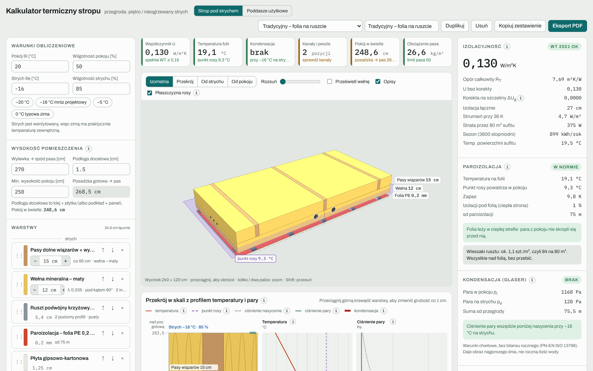
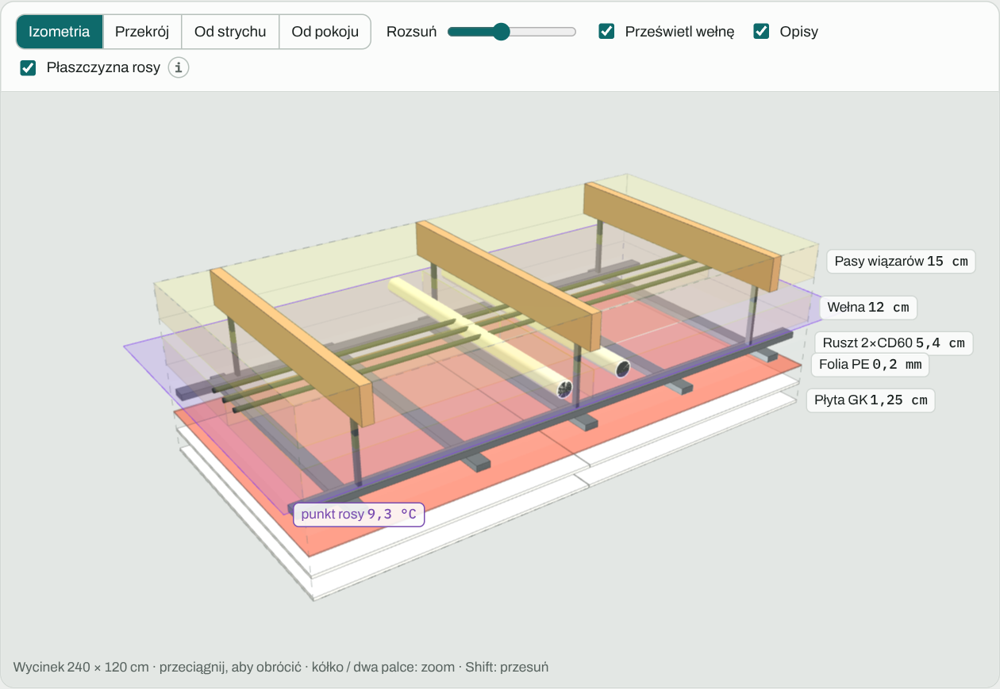
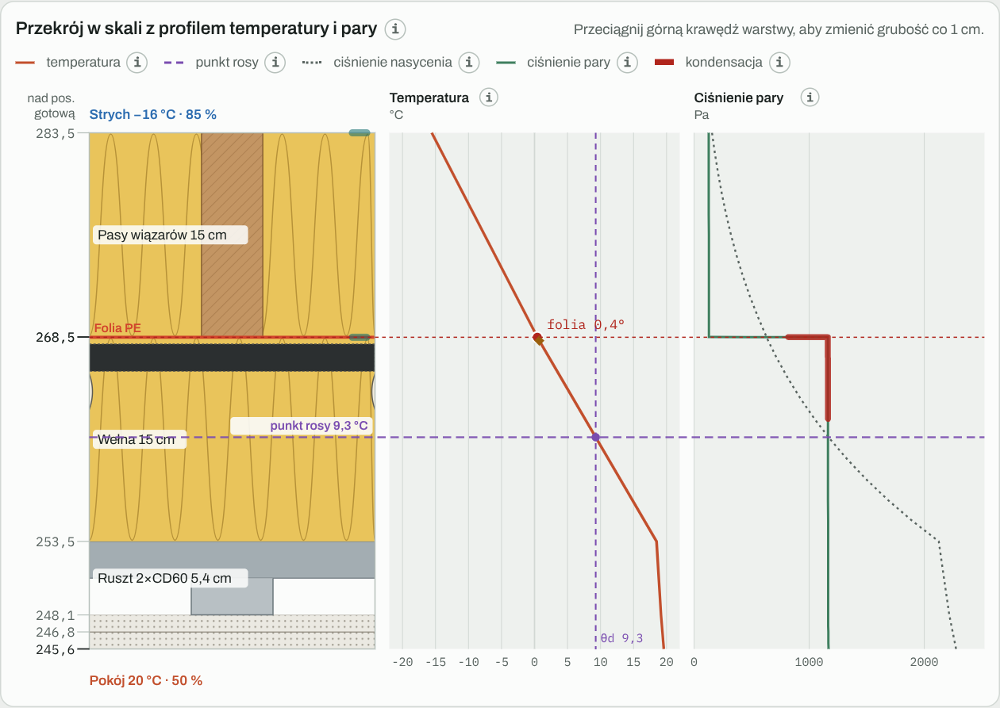
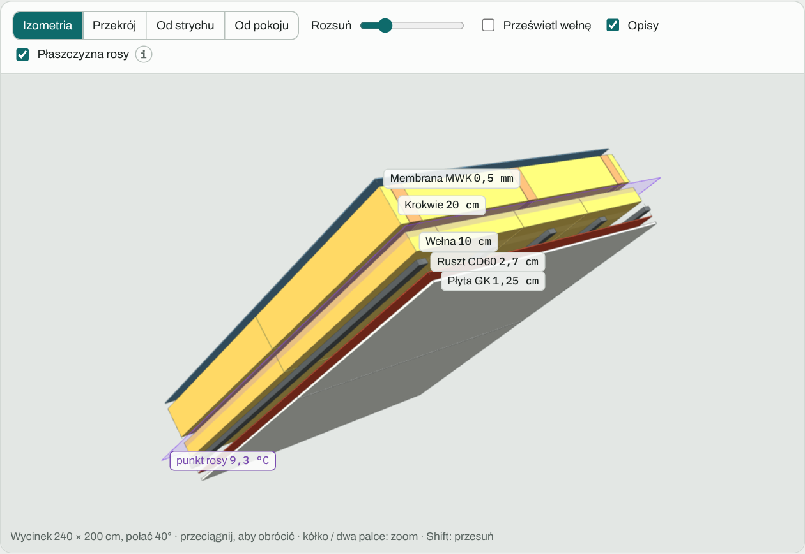
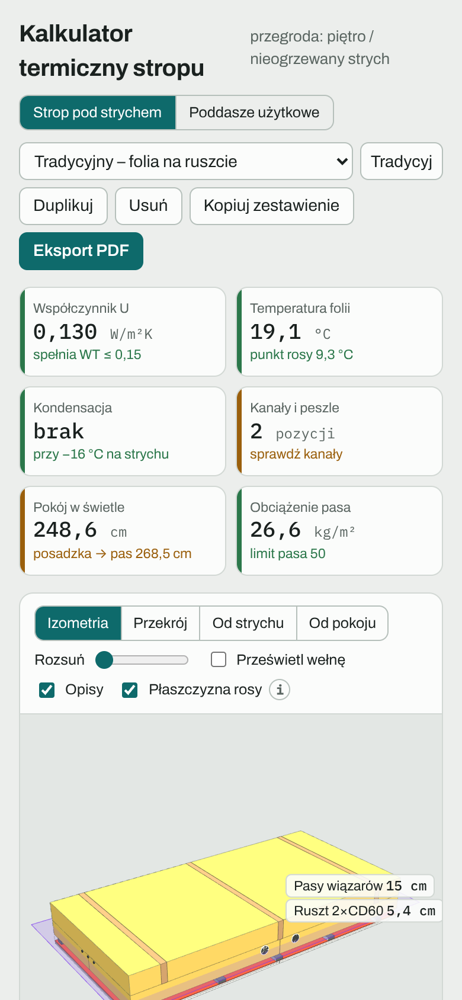

# Kalkulator termiczny stropu

Kalkulator przegrody dla domu jednorodzinnego: stropu pod nieogrzewanym strychem albo skosu poddasza użytkowego. Działa w przeglądarce, bez instalacji i bez serwera.

**[Otwórz kalkulator](https://mikebronka.github.io/termo-przegroda/)**

## Dwa tryby

- **Strop pod strychem:** belki stropu (pasy dolne wiązarów, jętki albo belki stropu drewnianego), strefa instalacyjna, ruszt CD (pusty lub wypełniony wełną), paroizolacja, płyty GK.
- **Poddasze użytkowe:** krokwie, membrana MWK, skos i ścianka kolankowa.

## Co liczy

- współczynnik U z korektą na szczeliny (PN-EN ISO 6946, metoda uproszczona),
- rozkład temperatury w przegrodzie, punkt rosy i temperaturę na paroizolacji,
- kondensację metodą Glasera dla warunków chwilowych (PN-EN ISO 13788),
- temperaturę przy kanałach rekuperacji i peszlach umieszczonych w izolacji,
- wysokość pomieszczenia w świetle albo wysokość skosu przy ściance i odległość do 1,4 m i 2,2 m (PN-ISO 9836),
- obciążenie belek i straty ciepła,
- opłacalność dodatkowej warstwy wełny: oszczędność na rachunkach dla wybranego źródła ciepła (pompa ciepła, gaz, prąd, pellet), koszt i czas zwrotu, także przy rosnących cenach energii.

## Widoki

**Model 3D** z rozsuniętymi warstwami i prześwietloną wełną: pasy wiązarów, kanały rekuperacji, peszle, ruszt z wieszakami, folia i płyty. Fioletowa płaszczyzna to miejsce, w którym przegroda ma temperaturę punktu rosy.

**Przekrój w skali** z profilem temperatury i ciśnienia pary. Tutaj wariant z folią w połowie izolacji: folia ma 0,4 °C przy punkcie rosy 9,3 °C, więc pod nią pojawia się kondensacja (czerwony odcinek).

**Tryb poddasza użytkowego:** połać pod kątem, krokwie, membrana MWK, wełna pod krokwiami, ruszt i płyta GK.

**Wersja na telefon:** najważniejsze wyniki na górze, pod nimi widok 3D i warstwy.

Pozostałe funkcje:

- przekrój w skali z profilami temperatury i ciśnienia pary,
- model 3D (three.js) z płaszczyzną punktu rosy,
- porównanie wariantów i eksport raportu PDF na A4.

Warianty zapisują się w pamięci przeglądarki (localStorage). Każdy użytkownik ma swoje i nic nie trafia na serwer.

Wyniki są pomocnicze. Decyzje wykonawcze warto skonsultować z projektantem.

## Uruchomienie

Wystarczy otworzyć `index.html` w przeglądarce. Wersja online działa przez GitHub Pages (Settings → Pages → Deploy from a branch → `main` / root).
