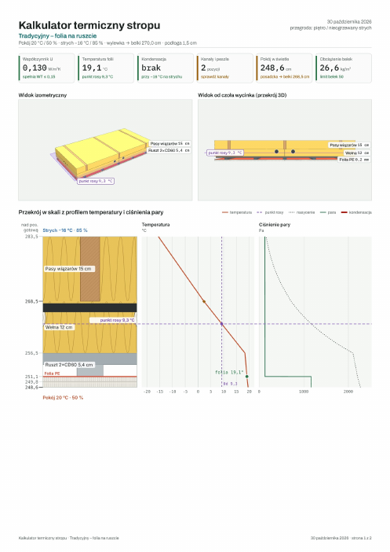
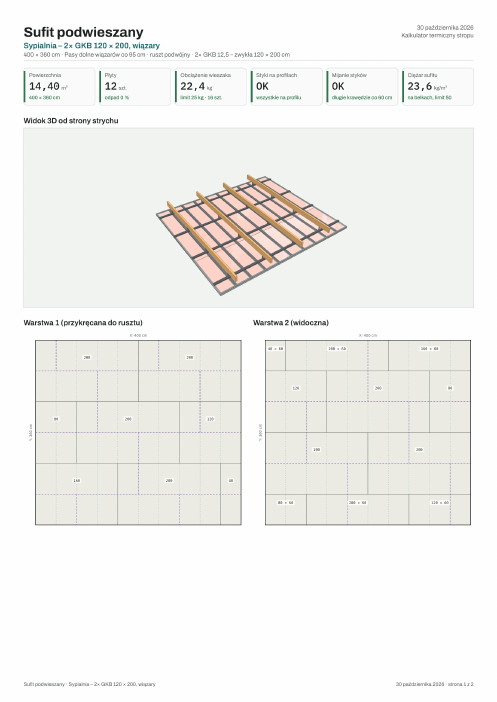
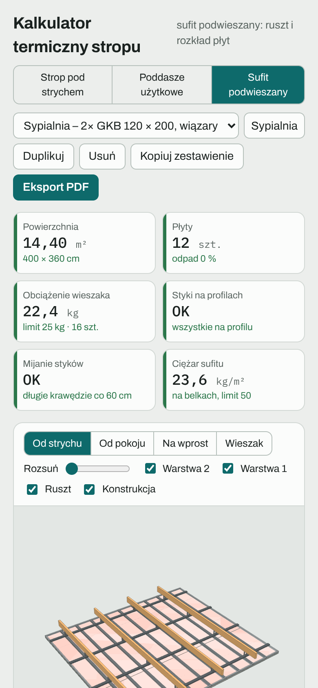

# Eksport PDF i udostępnianie

## Raport PDF

Przycisk **Eksport PDF** w nagłówku tworzy raport A4 dla bieżącego wariantu. Jeśli wszystko nie mieści się na jednej stronie, raport przechodzi na drugą. Nazwa pliku zawiera nazwę wariantu.

| Strop i poddasze | Sufit podwieszany |
|---|---|
|  |  |

**Strop i poddasze:**

- nagłówek z nazwą wariantu i warunkami,
- kafelki z wynikami,
- dwa widoki 3D (izometria i przekrój od czoła),
- przekrój w skali z wykresami temperatury i pary,
- lista warstw, tabela wyników (z opłacalnością docieplenia),
- kanały i instalacje, porównanie wariantów.

**Sufit podwieszany:**

- nagłówek z wymiarami i systemem, kafelki,
- widok 3D od strony strychu,
- plany obu warstw płyt i plan rusztu,
- lista kontrolna, zestawienie materiałów.

Plik pobiera się jak każdy inny plik z przeglądarki, do folderu pobranych.

## Kopiuj zestawienie

Przycisk **Kopiuj zestawienie** kopiuje do schowka krótkie podsumowanie tekstowe, gotowe do wklejenia w SMS-ie, komunikatorze albo mailu:

- **strop i poddasze:** warstwy od góry do dołu, warunki, U, temperatura folii, kondensacja, kanały, wysokości, ciężar i opłacalność dokładki,
- **sufit:** pomieszczenie, konstrukcja, ruszt, płyty, wyniki kontroli i pełna lista materiałów z ilościami.

## Udostępnianie

Najprościej wysłać link do kalkulatora: **https://mikebronka.github.io/termo-przegroda/**

Warianty są zapisane w pamięci przeglądarki, więc druga osoba po otwarciu linku zobaczy przykłady, a nie Twoje warianty. Żeby pokazać swój układ:

- wyślij PDF albo skopiowane zestawienie,
- albo pokaż kalkulator na swoim telefonie: najważniejsze wyniki są na samej górze.

## Gdzie są moje dane

- Wszystko zostaje w Twojej przeglądarce (localStorage). Nic nie jest wysyłane na serwer.
- Wyczyszczenie danych witryny, tryb prywatny albo inna przeglądarka oznaczają świeży start z przykładami.
- Plik `index.html` z repozytorium można zapisać i otwierać lokalnie. Widok 3D, czcionki i eksport PDF potrzebują wtedy internetu, bo biblioteki (three.js, jsPDF) są pobierane z CDN.

---

[← Spis treści](README.md) · [Otwórz kalkulator](https://mikebronka.github.io/termo-przegroda/)
