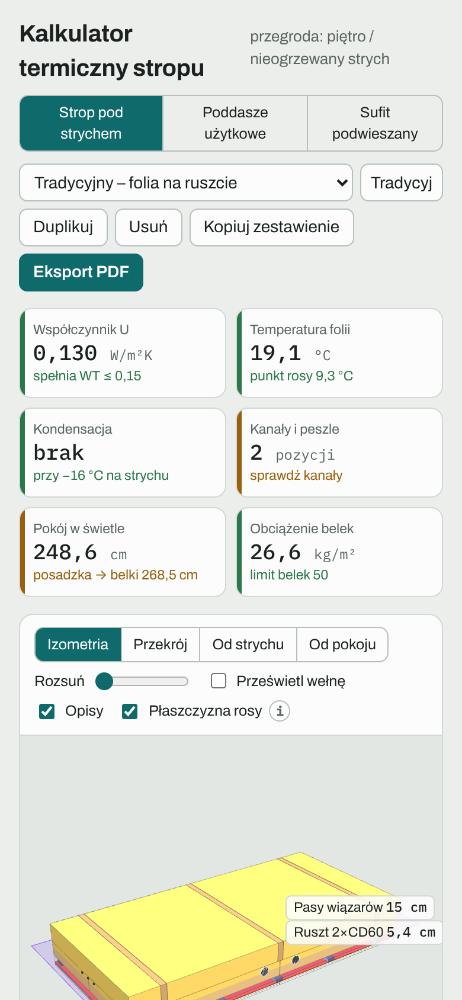
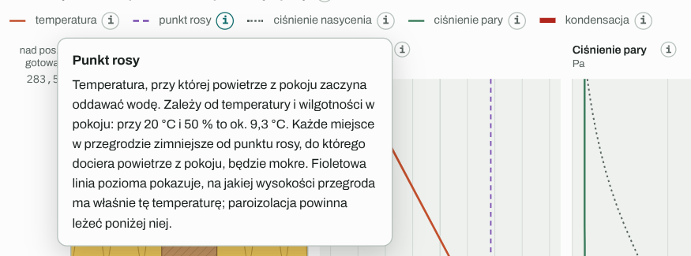
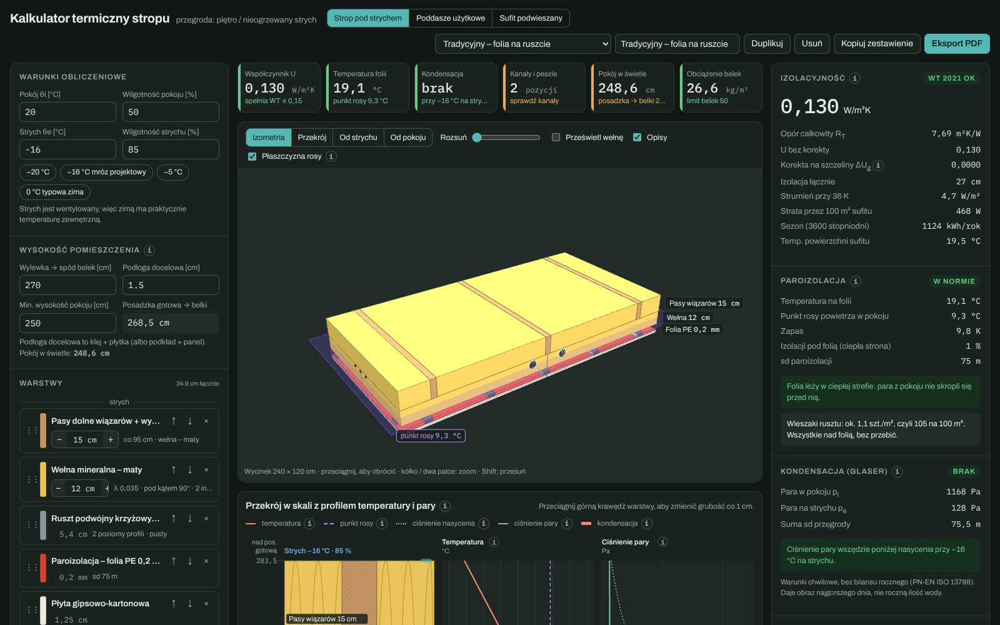

# Interfejs i warianty

## Układ ekranu

Na komputerze ekran ma trzy kolumny:

| Kolumna | Zawartość |
|---|---|
| Lewa | Dane wejściowe: warunki, wysokości i warstwy (w trybie sufitu: pomieszczenie, konstrukcja, ruszt, płyty, obciążenie). |
| Środkowa | Kafelki z najważniejszymi wynikami, widok 3D i przekrój w skali (w trybie sufitu: plan płyt i rusztu). |
| Prawa | Szczegółowe wyniki z opisem, co z nich wynika, i porównanie wariantów (w trybie sufitu: kontrola i zestawienie materiałów). |

Na węższym ekranie prawa kolumna przechodzi pod spód, a na telefonie wszystko układa się w jedną kolumnę w kolejności: kafelki, widok 3D, dane wejściowe, wyniki.

## Nagłówek

- **Przełącznik trybów:** Strop pod strychem, Poddasze użytkowe, Sufit podwieszany.
- **Lista wariantów:** wybór wariantu w bieżącym trybie. Ostatnia pozycja, „+ Nowy z przykładów…”, dodaje świeży komplet przykładów.
- **Pole nazwy:** zmiana nazwy bieżącego wariantu.
- **Duplikuj:** kopia bieżącego wariantu, idealna do porównań („co, jeśli dam 5 cm więcej?”).
- **Usuń:** usuwa bieżący wariant. Pierwsze kliknięcie zmienia napis na „Na pewno?”, drugie (w ciągu 3 s) usuwa.
- **Kopiuj zestawienie:** podsumowanie tekstowe do schowka.
- **Eksport PDF:** raport A4 (szczegóły w [Eksport PDF i udostępnianie](Eksport-PDF-i-udost%C4%99pnianie.md)).

## Warianty

Wariant to jeden zapisany układ przegrody (albo jeden sufit). Każdy tryb ma własną listę. Warianty zapisują się automatycznie w pamięci przeglądarki: po zamknięciu i ponownym otwarciu strony wszystko jest na miejscu. Pamięć jest przypisana do przeglądarki i urządzenia, więc na telefonie i na komputerze masz osobne zestawy.

Warunki obliczeniowe (temperatury, wilgotność, wysokości, ceny energii) są wspólne dla wszystkich wariantów, dzięki czemu porównanie w tabeli jest uczciwe.

## Ikonki „i”

Przy większości sekcji i na legendzie przekroju są okrągłe ikonki **i**. Kliknięcie otwiera krótkie wyjaśnienie: co pokazuje dana linia albo liczba i jak ją czytać. Okienko zamyka się klawiszem Esc albo kliknięciem obok.

## Widok 3D: sterowanie

| Gest | Działanie |
|---|---|
| Przeciągnięcie myszą lub palcem | obrót |
| Kółko myszy lub dwa palce | przybliżenie i oddalenie |
| Shift + przeciągnięcie (albo prawy przycisk) | przesunięcie widoku |
| Kliknięcie w warstwę | zaznaczenie jej na liście (tryby stropu i poddasza) |

Przyciski nad widokiem ustawiają gotowe kamery, a suwak **Rozsuń** rozsuwa warstwy w pionie, żeby zajrzeć między nie.

## Motyw jasny i ciemny

Kalkulator dopasowuje się do ustawień systemu. W trybie ciemnym kolory materiałów zostają realistyczne, a zmienia się tło i tekst.

---

[← Spis treści](README.md) · [Otwórz kalkulator](https://mikebronka.github.io/termo-przegroda/)
