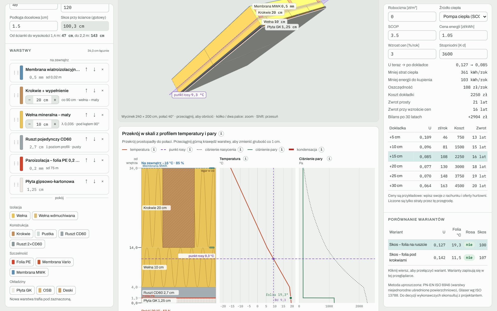
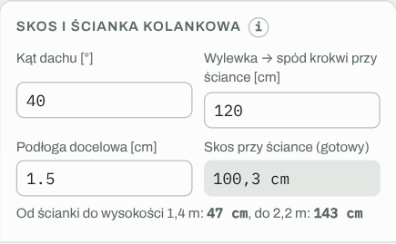
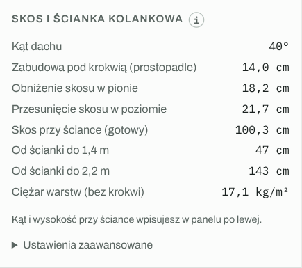

# Poddasze użytkowe

Tryb dla skosu dachu nad ogrzewanym poddaszem. Działa tak samo jak [Strop pod strychem](Strop-pod-strychem.md): te same warunki, warstwy, widok 3D, przekrój i wyniki. Różnice opisuje ta strona.

## Co się zmienia względem stropu

- **Kolejność warstw** biegnie od zewnątrz (góra) do pokoju (dół). Przekrój zaczyna się od membrany: pokrycie, łaty i szczelina wentylacyjna nad membraną nie liczą się do izolacyjności.
- **Krokwie** zastępują belki stropu. Domyślnie 8 × 20 cm co 90 cm, z wypełnieniem z wełny.
- **Membrana MWK** (wiatroizolacyjna, wysokoparoprzepuszczalna, sd ok. 0,02 m) jest w palecie w grupie „Szczelność”.
- **Widok 3D** pokazuje wycinek połaci pochylony pod kątem dachu. Płaszczyzna punktu rosy jest pochylona razem z nim.
- **Opłacalność docieplenia** dokłada wełnę pod krokwiami, a nie na wierzchu.

## Skos i ścianka kolankowa

| Pole | Znaczenie |
|---|---|
| Kąt dachu | nachylenie połaci w stopniach |
| Wylewka → spód krokwi przy ściance | wysokość od wylewki do spodu krokwi w miejscu ścianki kolankowej |
| Podłoga docelowa | grubość wykończenia podłogi |

Na tej podstawie kalkulator liczy:

- **skos przy ściance (gotowy):** wysokość po odjęciu podłogi i zabudowy pod krokwią przeliczonej na pion (grubość ÷ cos kąta),
- **odległość od ścianki do wysokości 1,4 m i 2,2 m.**

Według PN-ISO 9836 powierzchnia o wysokości co najmniej 2,2 m liczy się w 100 %, od 1,4 do 2,2 m w 50 %, a niższa nie wchodzi do powierzchni użytkowej. Każdy centymetr zabudowy pod krokwią przesuwa obie granice w głąb pokoju.

## Przykłady na start

- **Skos – folia na ruszcie:** 20 cm wełny między krokwiami, 10 cm pod krokwiami, ruszt, folia, płyta GK.
- **Skos – folia pod krokwiami:** krokwie 24 cm, folia od razu pod krokwiami, pod nią 5 cm wełny w strefie instalacyjnej.

Wskazówka: przy skosie zasada „najwyżej 1/3 izolacji pod folią” działa tak samo jak przy stropie. Fioletowa płaszczyzna punktu rosy pokazuje, czy folia ma bezpieczny zapas.

---

[← Spis treści](README.md) · [Otwórz kalkulator](https://mikebronka.github.io/termo-przegroda/)
