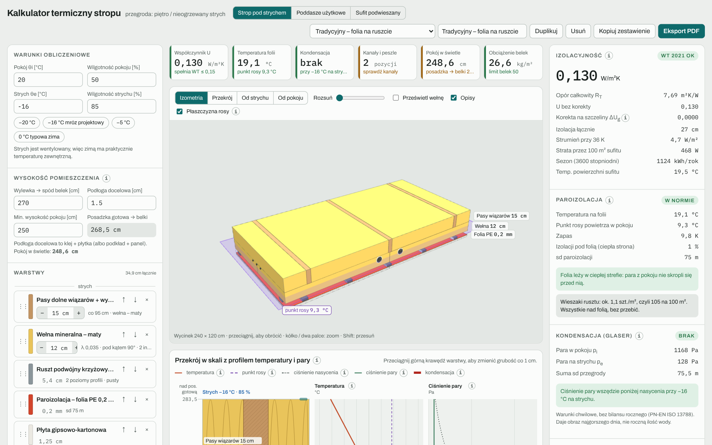

# Kalkulator termiczny stropu

Kalkulator w przeglądarce do projektowania przegród w domu jednorodzinnym: stropu pod nieogrzewanym strychem, skosu poddasza użytkowego i sufitu podwieszanego z płyt gipsowo-kartonowych. Nie wymaga instalacji ani konta, działa na komputerze i na telefonie.

**[Otwórz kalkulator](https://mikebronka.github.io/termo-przegroda/)** · [Repozytorium](https://github.com/mikebronka/termo-przegroda)

## Trzy tryby

| Tryb | Do czego służy |
|---|---|
| [Strop pod strychem](Strop-pod-strychem.md) | Układ warstw stropu pod zimnym strychem: współczynnik U, temperatura na paroizolacji, punkt rosy, kondensacja, kanały rekuperacji w izolacji, wysokość pokoju, obciążenie belek i opłacalność docieplenia. |
| [Poddasze użytkowe](Poddasze-u%C5%BCytkowe.md) | To samo dla skosu: krokwie, membrana MWK, wełna pod krokwiami, a do tego wysokość skosu przy ściance kolankowej i odległości do 1,4 m i 2,2 m. |
| [Sufit podwieszany](Sufit-podwieszany.md) | Ruszt CD pod wiązarami, jętkami, belkami albo stropem betonowym, rozkład płyt GK w jednej lub dwóch warstwach, kontrola mijania styków, obciążenie wieszaków i zestawienie materiałów. |

## Spis treści

1. [Szybki start](Szybki-start.md): pierwsze 5 minut z kalkulatorem.
2. [Interfejs i warianty](Interfejs-i-warianty.md): nagłówek, przełączanie trybów, warianty, kopiowanie, motyw jasny i ciemny.
3. [Strop pod strychem](Strop-pod-strychem.md): warunki, warstwy, instalacje w izolacji, widok 3D, przekrój, wyniki.
4. [Poddasze użytkowe](Poddasze-u%C5%BCytkowe.md): różnice względem stropu, skos i ścianka kolankowa.
5. [Sufit podwieszany](Sufit-podwieszany.md): ruszt, wieszaki, płyty, plan rozkładu, kontrola, materiały.
6. [Jak liczy kalkulator](Jak-liczy-kalkulator.md): wzory i założenia: U, temperatury, punkt rosy, Glaser, opłacalność, obciążenia.
7. [Biblioteka materiałów](Biblioteka-materia%C5%82%C3%B3w.md): wartości λ, μ, sd, gęstości, płyty, wieszaki.
8. [Eksport PDF i udostępnianie](Eksport-PDF-i-udost%C4%99pnianie.md): raport A4, kopiowanie zestawienia, zapis wariantów.
9. [Pytania i ograniczenia](Pytania-i-ograniczenia.md): najczęstsze pytania i to, czego kalkulator nie liczy.

## Najważniejsze zasady w skrócie

- **Paroizolacja po ciepłej stronie.** Folia musi leżeć tam, gdzie temperatura jest wyższa niż punkt rosy powietrza w pokoju. W praktyce pod folią (od strony pokoju) najwyżej ok. 1/3 izolacji. Kalkulator pokazuje to fioletową płaszczyzną punktu rosy.
- **Strop pod strychem: U ≤ 0,15 W/m²K** (Warunki Techniczne od 2021 r.). To zwykle ok. 30 cm wełny.
- **Krótkie krawędzie płyt GK zawsze na profilu.** Długość płyty będąca wielokrotnością rozstawu profili (np. 200 cm przy 40 cm) daje styki na profilu bez docinania.
- **Mijanie styków.** W jednej warstwie styki sąsiednich rzędów przesunięte o co najmniej jeden profil, a druga warstwa przesunięta względem pierwszej: krótkie styki o min. 40 cm, długie krawędzie o ok. 60 cm.

> Wyniki są pomocnicze i opierają się na metodach uproszczonych (PN-EN ISO 6946, PN-EN ISO 13788). Decyzje wykonawcze warto skonsultować z projektantem, a rozstawy rusztu i nośności wieszaków sprawdzić w karcie systemu producenta.
