# Strop pod strychem

Tryb do projektowania stropu między ogrzewanym piętrem a nieogrzewanym, wentylowanym strychem. Typowy układ: belki stropu (np. pasy dolne wiązarów) z wełną, pod nimi strefa instalacyjna, ruszt, paroizolacja i płyty GK.

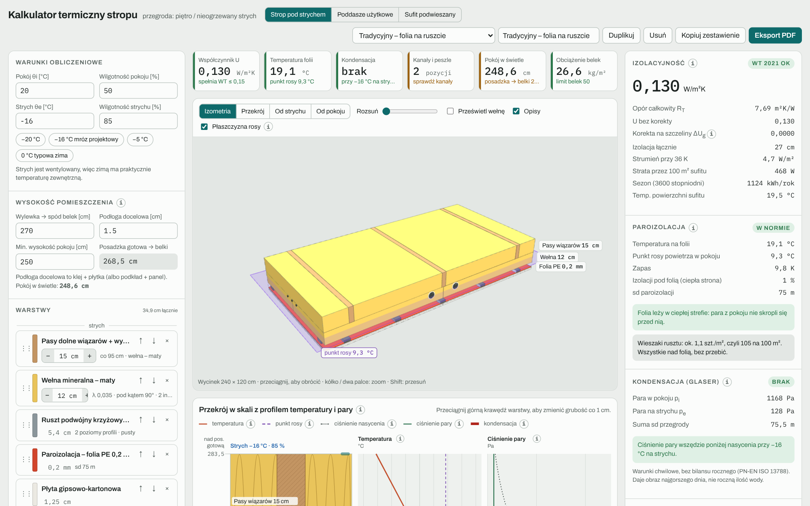

## Warunki obliczeniowe

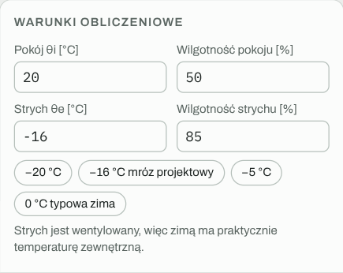

| Pole | Znaczenie | Wartość domyślna |
|---|---|---|
| Pokój θi | temperatura w pomieszczeniu | 20 °C |
| Wilgotność pokoju | wilgotność względna powietrza w pokoju | 50 % |
| Strych θe | temperatura na strychu; strych jest wentylowany, więc zimą to praktycznie temperatura zewnętrzna | −16 °C |
| Wilgotność strychu | wilgotność powietrza na strychu | 85 % |

Szybkie przyciski: −20 °C, −16 °C (mróz projektowy), −5 °C, 0 °C (typowa zima). Wyniki temperatury, kondensacji i kanałów dotyczą zawsze ustawionego stanu, więc warto sprawdzić zarówno mróz projektowy, jak i typową zimę.

## Wysokość pomieszczenia

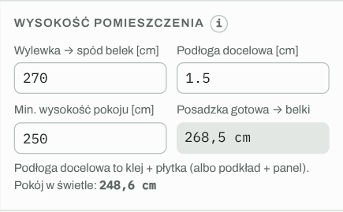

- **Wylewka → spód belek:** zmierzona na budowie odległość od wylewki do spodu belek stropu.
- **Podłoga docelowa:** grubość warstwy wykończeniowej (np. klej + płytka ok. 1,5 cm, podkład + panel ok. 1 cm).
- **Min. wysokość pokoju:** próg, poniżej którego kafelek „Pokój w świetle” zmienia kolor na ostrzegawczy.

Kalkulator liczy wysokość od posadzki gotowej do spodu belek i wysokość pokoju w świetle, czyli po odjęciu wszystkiego, co wisi pod belkami (strefa instalacyjna, ruszt, płyty).

## Warstwy

Lista biegnie od strychu (góra) do pokoju (dół). Pod nią jest paleta materiałów w czterech grupach: izolacja, konstrukcja, szczelność i okładziny.

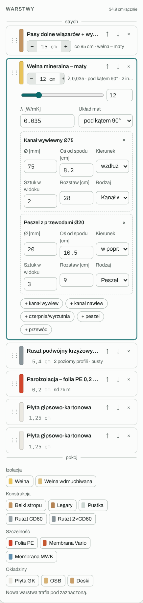

### Edycja warstwy

- **Grubość:** przyciski − / + co 1 cm, suwak w rozwiniętej karcie albo przeciągnięcie górnej krawędzi warstwy na przekroju. Płyty mają grubości do wyboru z listy, a membrany i ruszt mają grubość stałą.
- **Kolejność:** strzałki ↑ ↓ albo przeciągnięcie karty za uchwyt ⋮⋮.
- **Szczegóły** (po kliknięciu nazwy):
  - **Wełna:** λ i układ mat (prosto, na mijankę, pod kątem 90°). Układ wpływa na korektę na szczeliny.
  - **Belki stropu:** rodzaj (pasy dolne wiązarów, jętki, belki stropu drewnianego), rozstaw osiowy, szerokość drewna, wypełnienie (maty, wdmuchiwana, pustka), λ wypełnienia, kierunek.
  - **Legary:** to samo, z doliczaniem ciężaru drewna.
  - **Ruszt:** pusty albo wypełniony wełną między profilami.
  - **Membrany:** opór dyfuzyjny sd.

### Instalacje w izolacji

W warstwach wełny, belek i pustki możesz umieścić kanały i przewody:

| Element | Domyślna średnica | Co sprawdza kalkulator |
|---|---|---|
| Kanał wywiewny | 75 mm | temperaturę nad kanałem względem punktu rosy powietrza z łazienek, grubość izolacji nad kanałem |
| Kanał nawiewny | 75 mm | stratę ciepła nawiewu |
| Kanał czerpni / wyrzutni | 160 mm | czy zimny kanał nie leży po ciepłej stronie folii |
| Peszel z przewodami | 20 mm | czy leży pod folią (dostęp bez przebijania) czy nad nią |
| Przewód | 10 mm | jak wyżej |

Dla każdego elementu ustawiasz średnicę, wysokość osi od spodu warstwy, kierunek (wzdłuż lub w poprzek), liczbę sztuk w widoku i rozstaw. Kanały i peszle widać w 3D i na przekroju.

## Widok 3D

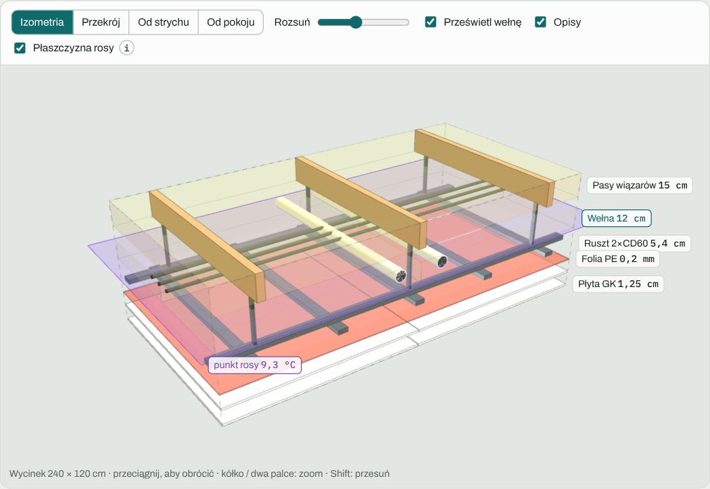

- **Kamery:** Izometria, Przekrój (od czoła), Od strychu, Od pokoju.
- **Rozsuń:** rozsuwa warstwy w pionie.
- **Prześwietl wełnę:** wełna staje się półprzezroczysta, widać belki, kanały i peszle.
- **Opisy:** etykiety z nazwą i grubością każdej warstwy.
- **Płaszczyzna rosy:** fioletowa, półprzezroczysta płaszczyzna na wysokości, na której przegroda ma temperaturę punktu rosy powietrza z pokoju. Paroizolacja powinna leżeć poniżej niej.

Wycinek w 3D ma 240 × 120 cm. Rozstaw belek, kanałów i profili jest w skali.

## Przekrój w skali

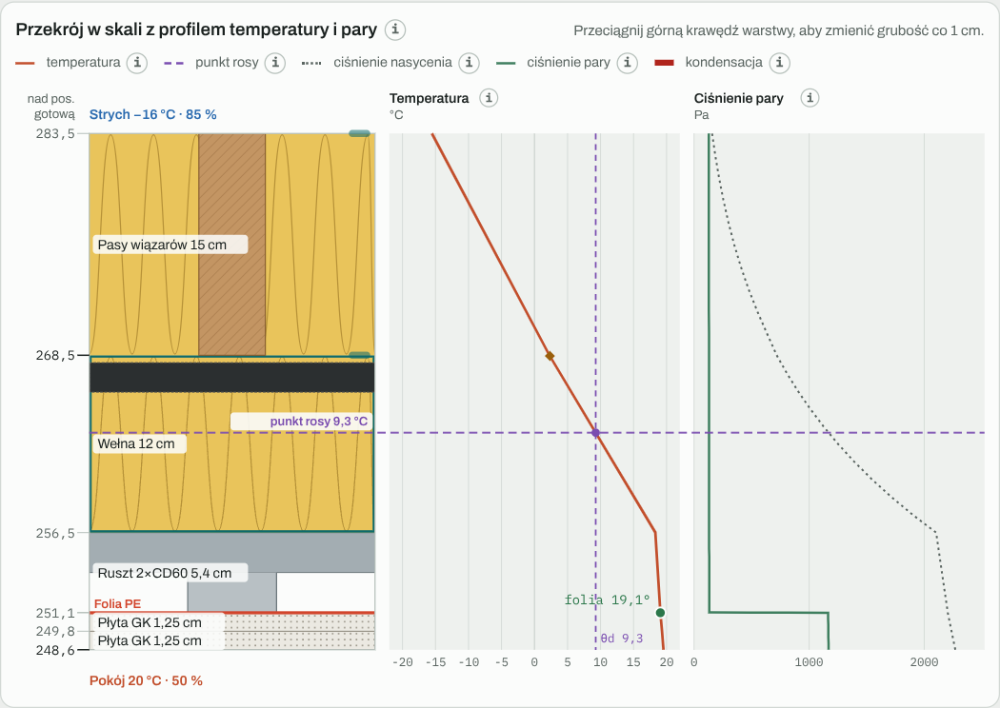

Lewa kolumna to przegroda w prawdziwej skali, a linijka podaje wysokość każdej granicy warstw nad posadzką gotową. Dwa wykresy obok mają tę samą skalę pionową:

- **Temperatura:** jak spada od pokoju do strychu. W wełnie linia jest pochyła, w płytach prawie pionowa. Kropka pokazuje temperaturę na folii, a romby temperaturę nad kanałami.
- **Ciśnienie pary:** zielona linia to para, która rzeczywiście jest w danym miejscu, kropkowana to ciśnienie nasycenia. Gdzie zielona przechodzi nad kropkowaną, para się skrapla (czerwony odcinek).
- **Fioletowa przerywana linia** przechodzi przez wszystkie trzy kolumny na wysokości punktu rosy.

Tak wygląda błąd z folią w połowie izolacji: folia ma 0,4 °C, punkt rosy to 9,3 °C, a pod folią pojawia się kondensacja.

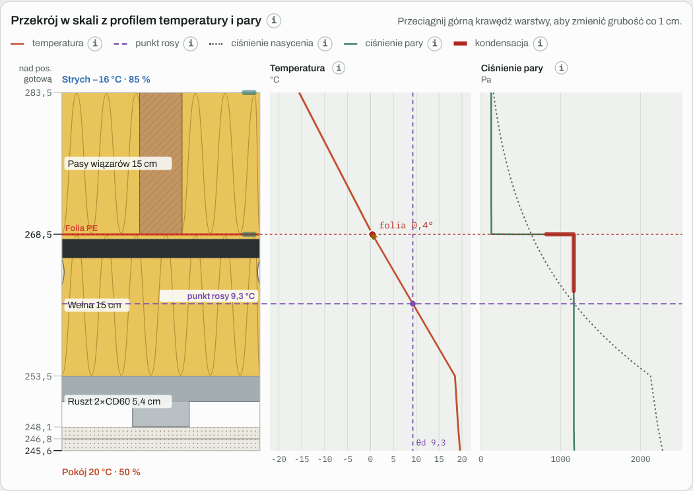

## Wyniki

### Izolacyjność

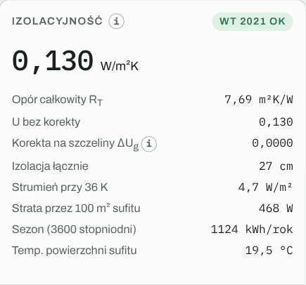

Współczynnik U z korektą na szczeliny, opór całkowity, łączna grubość izolacji, strumień ciepła, strata przez cały sufit, zużycie na sezon i temperatura powierzchni sufitu. Wymaganie WT 2021: U ≤ 0,15 W/m²K.

### Paroizolacja

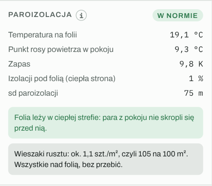

Temperatura na folii, punkt rosy, zapas, udział izolacji pod folią i sd. Status:

- zielony: zapas ≥ 2 K,
- pomarańczowy: 0–2 K,
- czerwony: folia zimniejsza od punktu rosy.

Wiersz o wieszakach mówi, ile mocowań rusztu przechodzi przez folię.

### Kondensacja (Glaser)

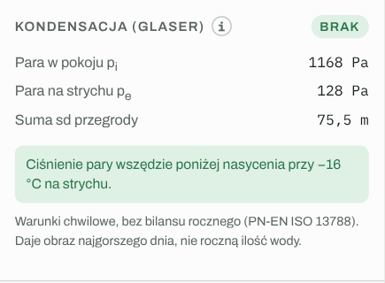

Ciśnienie pary w pokoju i na strychu, suma sd przegrody i ewentualna ilość kondensatu w g/m² na dobę przy ustawionych warunkach.

### Kanały i instalacje

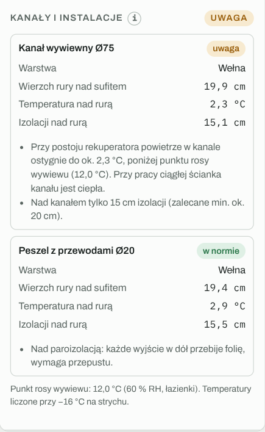

Dla każdego elementu: warstwa, wysokość wierzchu nad sufitem, temperatura nad rurą i grubość izolacji nad nią, z oceną. Kanał wywiewny jest oceniany ostrożnie, jakby rekuperacja stała. Przy ciągłej pracy ścianka kanału jest ciepła.

### Wysokość i obciążenie

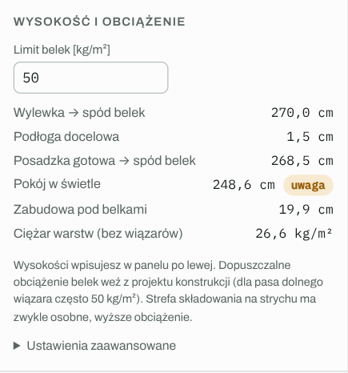

Wysokości, zabudowa pod belkami i ciężar warstw (bez belek) porównany z dopuszczalnym obciążeniem belek. Dla pasa dolnego wiązara projekt często zakłada 50 kg/m².

### Opłacalność docieplenia

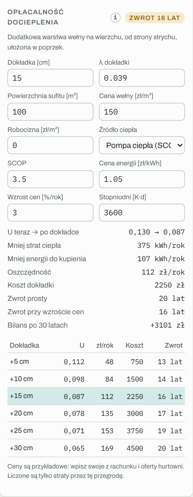

Kalkulator dokłada wybraną grubość wełny (na stropie od strony strychu) i liczy:

- U przed i po, mniej strat ciepła i mniej energii do kupienia,
- oszczędność w zł na rok i koszt dokładki,
- zwrot prosty i zwrot przy rosnących cenach energii, bilans po 30 latach,
- tabelę dla dokładek od 5 do 30 cm.

Źródła ciepła do wyboru: pompa ciepła (SCOP), kocioł gazowy, ogrzewanie elektryczne, kocioł na pellet. Wybór podstawia przykładową sprawność i cenę energii, które możesz nadpisać swoimi z rachunku.

### Porównanie wariantów

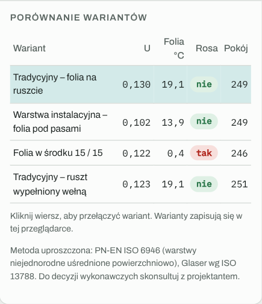

Wszystkie warianty bieżącego trybu przy tych samych warunkach: U, temperatura folii, kondensacja i wysokość pokoju. Kliknięcie wiersza przełącza wariant.

Szczegóły wzorów: [Jak liczy kalkulator](Jak-liczy-kalkulator.md).

---

[← Spis treści](README.md) · [Otwórz kalkulator](https://mikebronka.github.io/termo-przegroda/)
