# Sufit podwieszany

Planer sufitu z płyt gipsowo-kartonowych na ruszcie z profili CD. Rysuje ruszt i rozkład płyt, sprawdza obciążenie wieszaków, rozstawy i mijanie styków, a na końcu daje zestawienie materiałów do zamówienia.

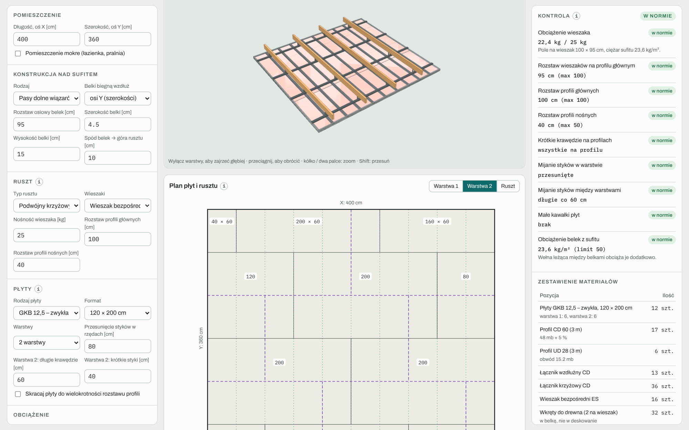

Kafelki nad widokiem 3D podsumowują wynik: powierzchnię, liczbę płyt z odpadem, obciążenie wieszaka, styki na profilach, mijanie styków i ciężar sufitu.

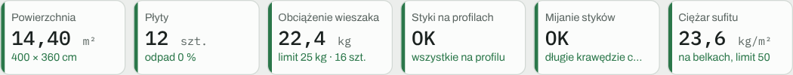

## Dane wejściowe

### Pomieszczenie

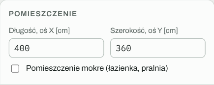

Długość (oś X) i szerokość (oś Y) w centymetrach. **Pomieszczenie mokre** (łazienka, pralnia) ogranicza rozstaw profili nośnych do 40 cm i ostrzega przy płycie zwykłej zamiast impregnowanej.

### Konstrukcja nad sufitem

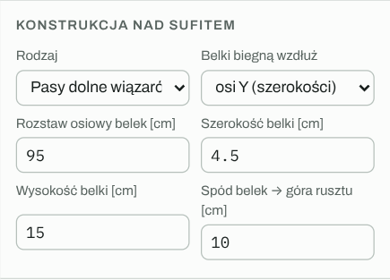

| Pole | Znaczenie |
|---|---|
| Rodzaj | pasy dolne wiązarów, jętki, belki stropu drewnianego albo strop betonowy / gęstożebrowy |
| Belki biegną wzdłuż | osi Y albo osi X; przy stropie betonowym pole określa kierunek profili nośnych |
| Rozstaw osiowy belek | odległość między osiami belek |
| Szerokość i wysokość belki | wymiary przekroju, do rysunku i rozmieszczenia wieszaków |
| Spód belek → góra rusztu | wysokość strefy instalacyjnej, czyli długość wieszaka |

### Ruszt

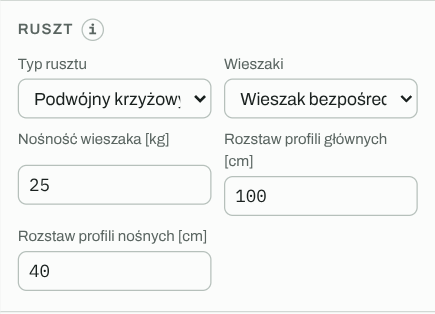

- **Podwójny krzyżowy:** profile główne CD 60 wiszą na wieszakach w poprzek belek, profile nośne CD 60 leżą pod nimi i są spięte łącznikami krzyżowymi. Wieszak jest na każdym skrzyżowaniu profilu głównego z belką.
- **Pojedynczy:** profile CD wiszą bezpośrednio na wieszakach, w poprzek belek. Wieszak jest pod każdą belką na każdym profilu.
- **Wieszaki:** bezpośredni ES, noniuszowy albo obrotowy z prętem, każdy z nośnością (domyślnie ostrożnie: 25, 40 i 25 kg). Zmiana typu podstawia jego domyślną nośność.
- **Rozstawy:** profili głównych (w ruszcie podwójnym), profili nośnych, a przy stropie betonowym także wieszaków.

Wzdłuż ścian zawsze biegnie profil UD 28 na taśmie akustycznej.

### Płyty

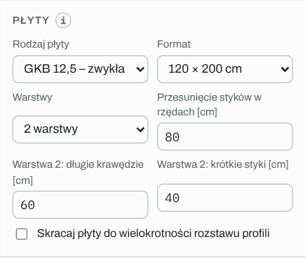

- **Rodzaj:** GKB 12,5, GKBI 12,5 (impregnowana), GKF 12,5 (ogniochronna), GKFI 12,5, utwardzona 12,5 (np. Diamant), GKB 15.
- **Format:** 120 × 200, 250, 260, 280 albo 300 cm.
- **Warstwy:** 1 albo 2.
- **Przesunięcie styków w rzędach:** o ile przesuwają się krótkie styki w kolejnych rzędach tej samej warstwy (np. 80 cm, czyli dwa profile).
- **Warstwa 2: długie krawędzie / krótkie styki:** przesunięcie drugiej warstwy względem pierwszej (domyślnie 60 i 40 cm).
- **Skracaj płyty do wielokrotności rozstawu profili:** np. 260 → 240 cm przy profilach co 40 cm. Styki wypadają wtedy na profilach, kosztem odpadu.

### Obciążenie i ustawienia zaawansowane

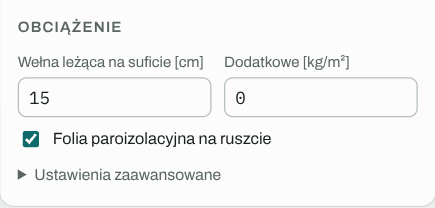

- **Wełna leżąca na suficie:** grubość wełny, która opiera się na płytach (np. 10 cm w strefie instalacyjnej + 5 cm w ruszcie). Liczona jako 0,2 kg/m² na każdy centymetr.
- **Dodatkowe obciążenie:** lampy, okap, głośniki (kg/m²).
- **Folia paroizolacyjna na ruszcie:** dolicza folię i taśmy do zestawienia.
- **Zaawansowane:**
  - odległości pierwszej belki, profilu głównego i profilu nośnego od ściany,
  - długość profili (3 albo 4 m),
  - rozstaw wkrętów w każdej warstwie,
  - limity rozstawów i najkrótszy dopuszczalny kawałek płyty.

## Widok 3D

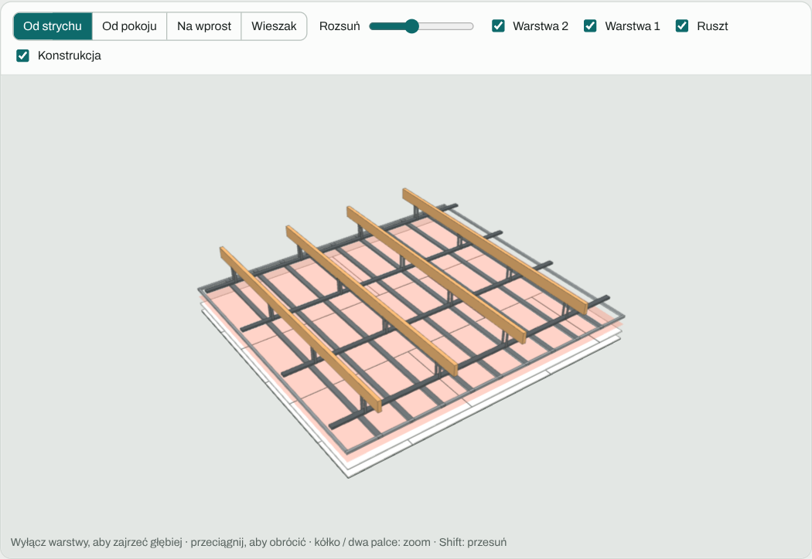

Model pokazuje belki (albo strop betonowy), wieszaki, profile główne i nośne, UD przy ścianach, folię i obie warstwy płyt. Warstwa 1 jest odrobinę ciemniejsza od warstwy 2. Styki do poprawy są zaznaczone na czerwono.

- **Kamery:** Od strychu, Od pokoju, Na wprost (prosto od dołu) i **Wieszak**.
- **Rozsuń:** rozsuwa warstwy w pionie.
- **Przełączniki** Warstwa 2, Warstwa 1, Ruszt i Konstrukcja ukrywają poszczególne części. Wyłączenie warstwy 2 w widoku od pokoju pokazuje układ warstwy 1.

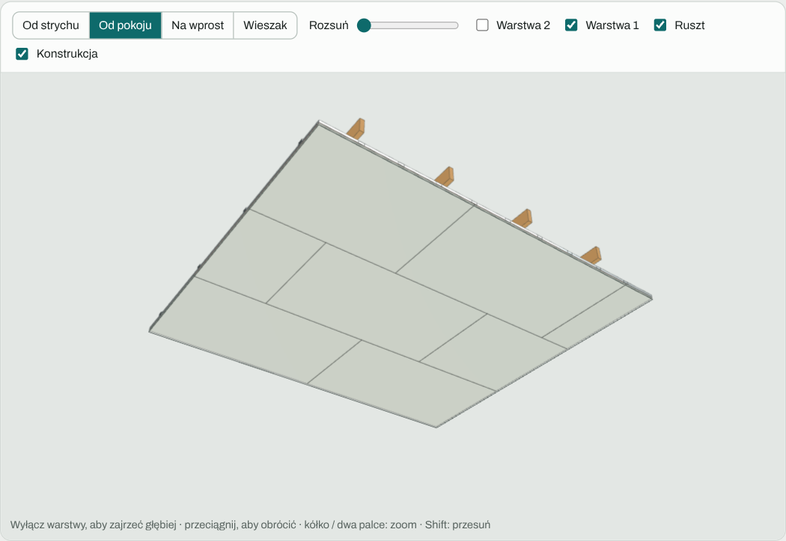

### Typy wieszaków w zbliżeniu

Przycisk **Wieszak** przybliża kamerę do wieszaka najbliżej środka pokoju, patrząc wzdłuż belki.

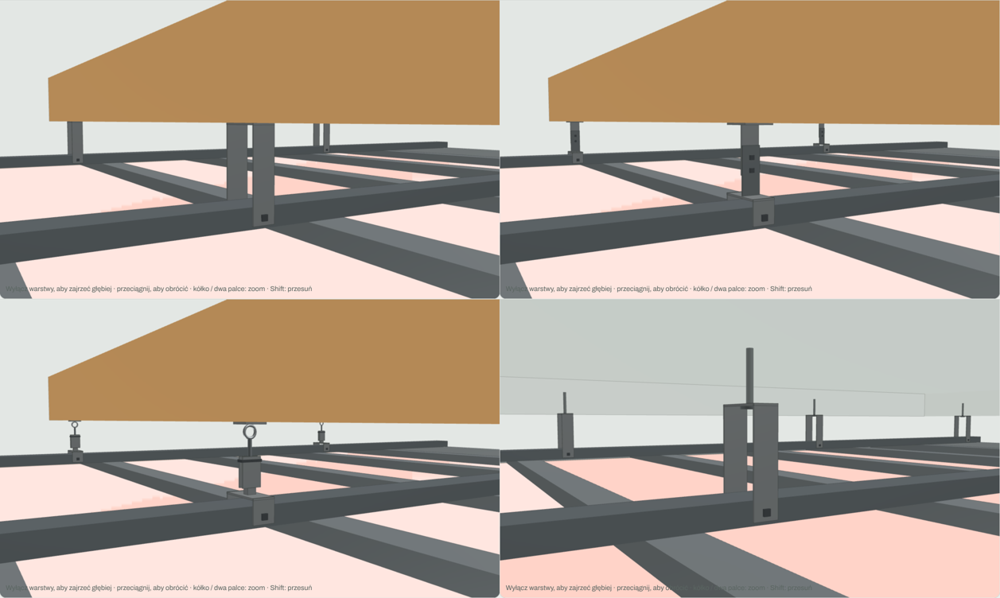

Od lewej u góry:

- **Wieszak bezpośredni ES pod belką:** strzemię w kształcie odwróconego U, przykręcone pod belką, ramiona po bokach profilu.
- **Wieszak noniuszowy:** górna część przy belce, dolna ze strzemieniem na profilu, spięte zawleczkami.
- **Wieszak obrotowy z prętem:** pręt z oczkiem, wieszak sprężynowy, zawiesie na profilu.
- **ES przy stropie betonowym:** mocowanie kotwą.

## Plan płyt i rusztu

Rzut z góry w skali, w trzech zakładkach: **Warstwa 1**, **Warstwa 2** i **Ruszt**.

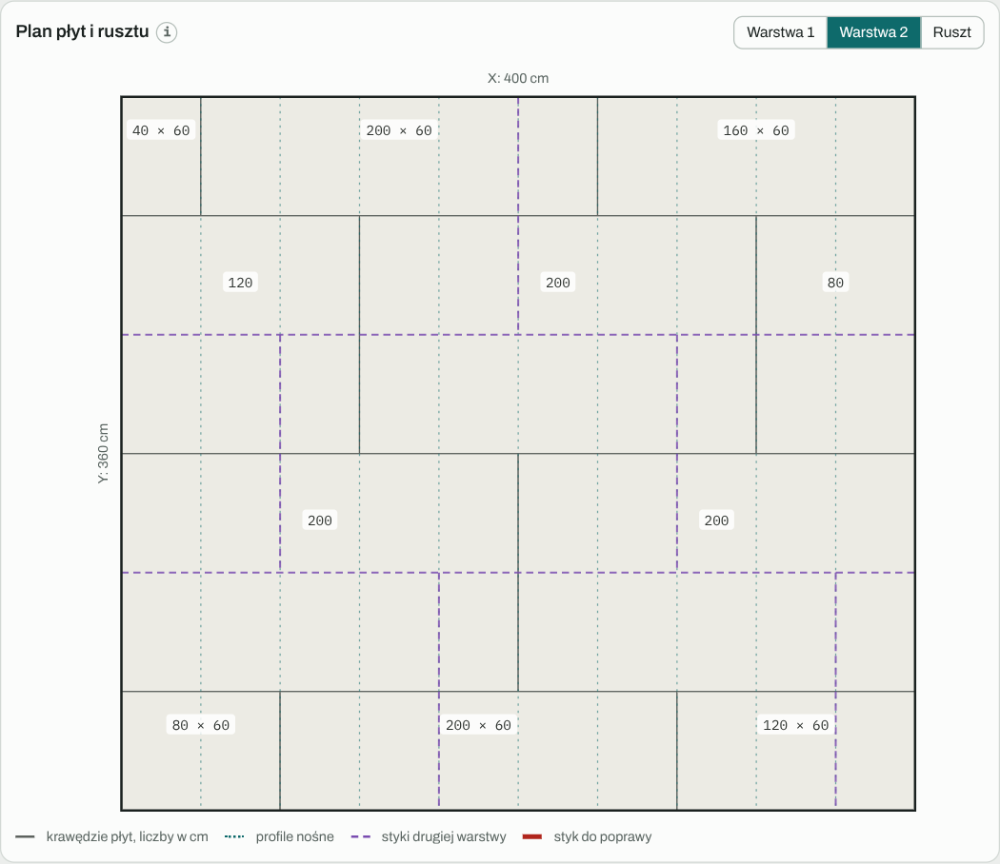

- Liczba w każdym kawałku to jego długość w cm. W przyciętych rzędach dochodzi szerokość, np. „160 × 60”.
- Cienkie turkusowe linie kropkowane to profile nośne: każdy krótki styk powinien leżeć na jednej z nich.
- Fioletowe linie przerywane to styki drugiej warstwy, więc od razu widać mijanie.
- Czerwone linie to styki do poprawy.

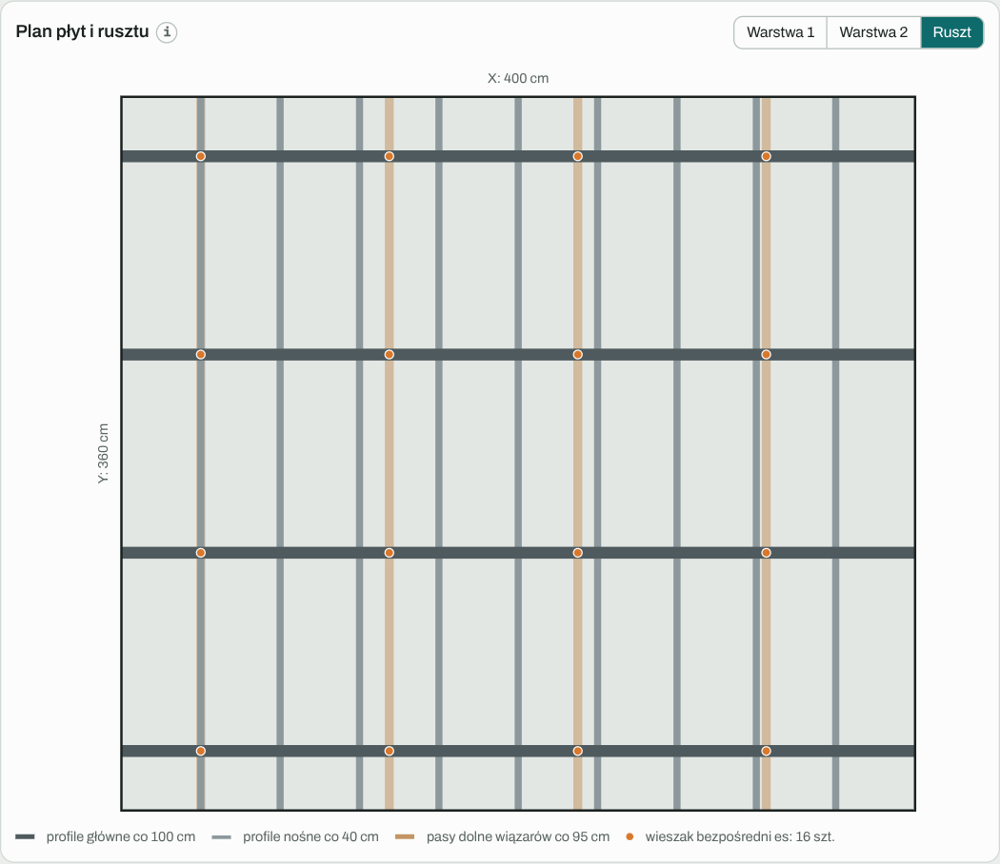

Warstwa 1 z fioletowymi stykami warstwy 2 nad nią. Żaden czerwony odcinek oznacza, że styki obu warstw się mijają.

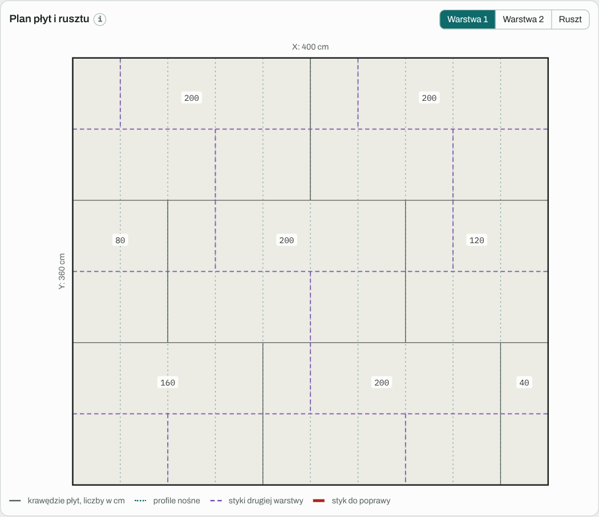

Zakładka Ruszt pokazuje belki, profile główne i nośne oraz wieszaki (pomarańczowe kropki), a legenda podaje rozstawy i liczbę wieszaków.

### Przykład: płyty 120 × 260 cm przy profilach co 40 cm

260 nie dzieli się przez 40, więc część krótkich styków wypada między profilami. Kalkulator zaznacza je na czerwono i podpowiada, co zmienić.

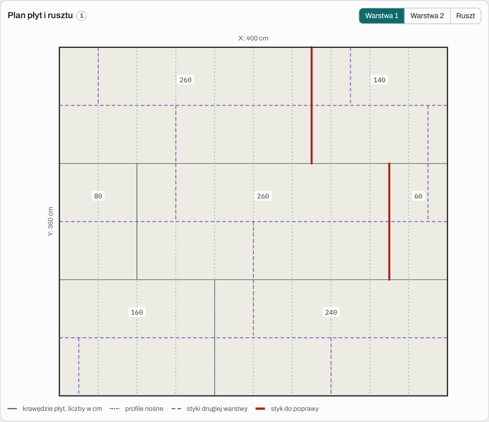

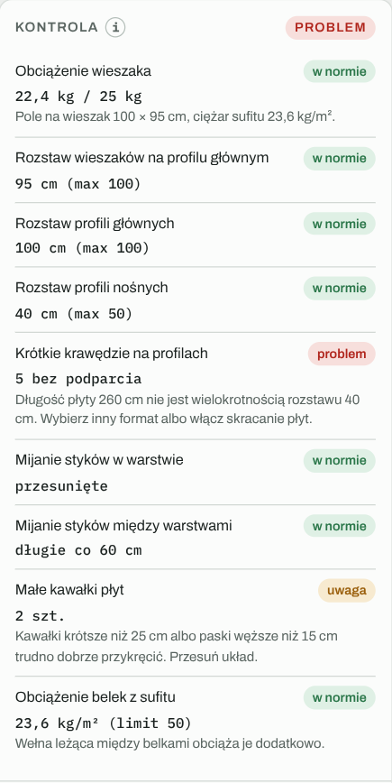

## Kontrola

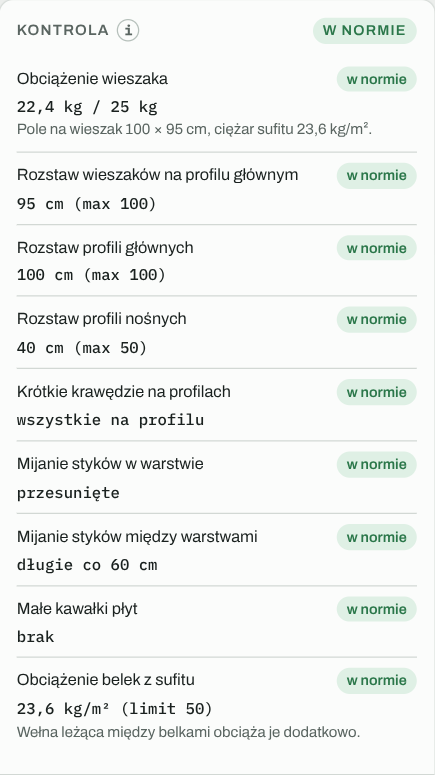

| Sprawdzenie | Kiedy ostrzega |
|---|---|
| Obciążenie wieszaka | ciężar sufitu z pola przypadającego na wieszak przekracza nośność |
| Rozstaw wieszaków | większy niż limit (domyślnie 100 cm) |
| Rozstaw profili głównych | większy niż limit (domyślnie 100 cm) |
| Rozstaw profili nośnych | większy niż limit (50 cm, w pomieszczeniu mokrym 40 cm) |
| Krótkie krawędzie na profilach | styk płyty nie trafia na profil nośny |
| Mijanie styków w warstwie | styki sąsiednich rzędów bliżej niż jeden rozstaw profili |
| Mijanie styków między warstwami | krótki styk warstwy 2 bliżej niż 40 cm od styku warstwy 1, albo długie krawędzie bliżej niż 30 cm |
| Małe kawałki płyt | kawałek krótszy niż ustawione minimum albo pasek węższy niż 15 cm |
| Płyta do pomieszczenia mokrego | zwykła płyta w łazience |
| Obciążenie belek z sufitu | ciężar sufitu większy niż dopuszczalne obciążenie belek z trybu stropu |

## Zestawienie materiałów

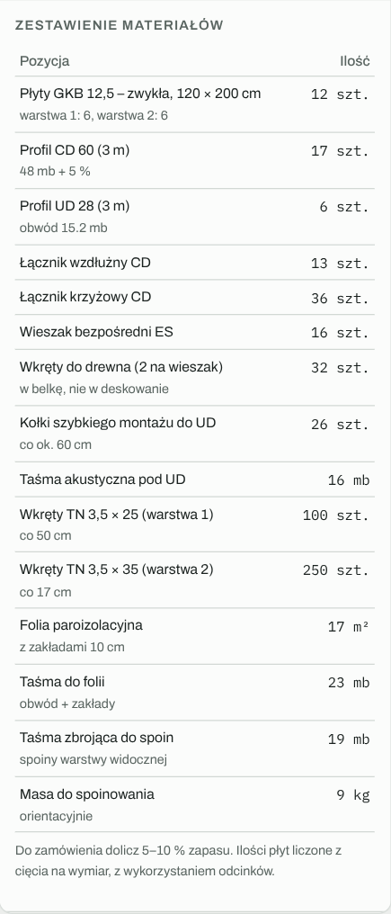

- **Płyty:** liczone z cięcia na wymiar, z wykorzystaniem odcinków. Wąskie paski z jednej płyty liczą się razem.
- **Profile CD 60 i UD 28:** w sztukach wybranej długości, z 5 % zapasu na docinki.
- **Łączniki wzdłużne i krzyżowe, wieszaki, pręty** (przy wieszakach obrotowych).
- **Mocowania:** wkręty do drewna (2 na wieszak) albo kotwy do betonu.
- **Kołki szybkiego montażu do UD i taśma akustyczna.**
- **Wkręty TN:** długość dobrana do grubości płyt; przy dwóch warstwach osobno dla każdej warstwy.
- **Folia i taśma do folii** (jeśli zaznaczona).
- **Taśma zbrojąca i masa do spoinowania**, orientacyjnie.

Do zamówienia dolicz 5–10 % zapasu.

### Ciężar sufitu

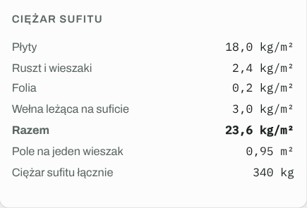

Rozbicie ciężaru na płyty, ruszt, folię, wełnę i obciążenie dodatkowe, pole przypadające na jeden wieszak i łączny ciężar sufitu.

> Limity rozstawów i nośności wieszaków są orientacyjne. Dla swojego obciążenia sprawdź tabelę w karcie systemu producenta (np. Knauf D112, Rigips 4.30) i wpisz jej wartości w ustawieniach zaawansowanych.

---

[← Spis treści](README.md) · [Otwórz kalkulator](https://mikebronka.github.io/termo-przegroda/)
