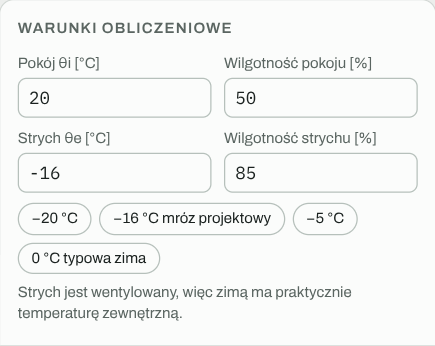
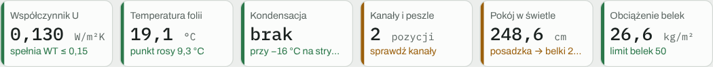

# Szybki start

Kalkulator otwiera się od razu z gotowymi przykładami, więc najprościej zacząć od jednego z nich i zmieniać go pod swój dom.

## 1. Wybierz tryb

U góry, obok nazwy, są trzy przyciski: **Strop pod strychem**, **Poddasze użytkowe** i **Sufit podwieszany**. Każdy tryb ma własną listę wariantów, więc przełączanie niczego nie kasuje.

## 2. Wybierz przykład albo zacznij od swojego

Lista rozwijana w nagłówku zawiera warianty. W trybie stropu na start są cztery:

- **Tradycyjny – folia na ruszcie:** wełna między belkami i w strefie instalacyjnej, folia na ruszcie, 2× GK.
- **Warstwa instalacyjna – folia pod pasami:** folia przyklejona pod belkami, pod nią pustka na instalacje.
- **Folia w środku 15 / 15:** przykład błędu. Folia leży w połowie izolacji, jest zimniejsza niż punkt rosy i pod nią pojawia się kondensacja.
- **Tradycyjny – ruszt wypełniony wełną:** jak pierwszy, ale z wełną także między profilami rusztu.

Kliknij **Duplikuj**, żeby zrobić własną kopię, i zmień nazwę w polu obok listy.

## 3. Ustaw warunki

W lewym panelu wpisz temperaturę i wilgotność w pokoju oraz na strychu. Przyciski z temperaturami ustawiają typowe wartości jednym kliknięciem: −16 °C to mróz projektowy dla większości Polski, 0 °C to typowa zima.

## 4. Dopasuj warstwy

Lista warstw biegnie od strychu (góra) do pokoju (dół). Każdą warstwę możesz:

- pogrubić lub odchudzić przyciskami **−** i **+** (co 1 cm) albo przeciągając jej górną krawędź na przekroju,
- przesunąć strzałkami **↑ ↓** albo przeciągając za uchwyt **⋮⋮**,
- rozwinąć kliknięciem w nazwę, żeby zmienić szczegóły (λ, układ mat, rozstaw belek, wypełnienie, instalacje),
- usunąć przyciskiem **×**.

Nowe warstwy dodajesz z palety pod listą. Nowa warstwa trafia pod zaznaczoną.

## 5. Czytaj wyniki

Kafelki nad widokiem 3D podsumowują najważniejsze wyniki. Kolor paska po lewej mówi wszystko na pierwszy rzut oka: zielony to w normie, pomarańczowy to uwaga, czerwony to problem.

Szczegóły są w prawym panelu, a każda sekcja ma ikonkę **i** z wyjaśnieniem.

## 6. Pokaż wynik innym

- **Eksport PDF** tworzy raport A4 z widokami 3D, przekrojem i wszystkimi wynikami.
- **Kopiuj zestawienie** kopiuje krótkie podsumowanie tekstowe do wklejenia w SMS-ie lub mailu.
- Na telefonie najważniejsze wyniki są na samej górze, więc kalkulator da się pokazać na budowie.

Więcej: [Interfejs i warianty](Interfejs-i-warianty.md), [Eksport PDF i udostępnianie](Eksport-PDF-i-udost%C4%99pnianie.md).

---

[← Spis treści](README.md) · [Otwórz kalkulator](https://mikebronka.github.io/termo-przegroda/)
